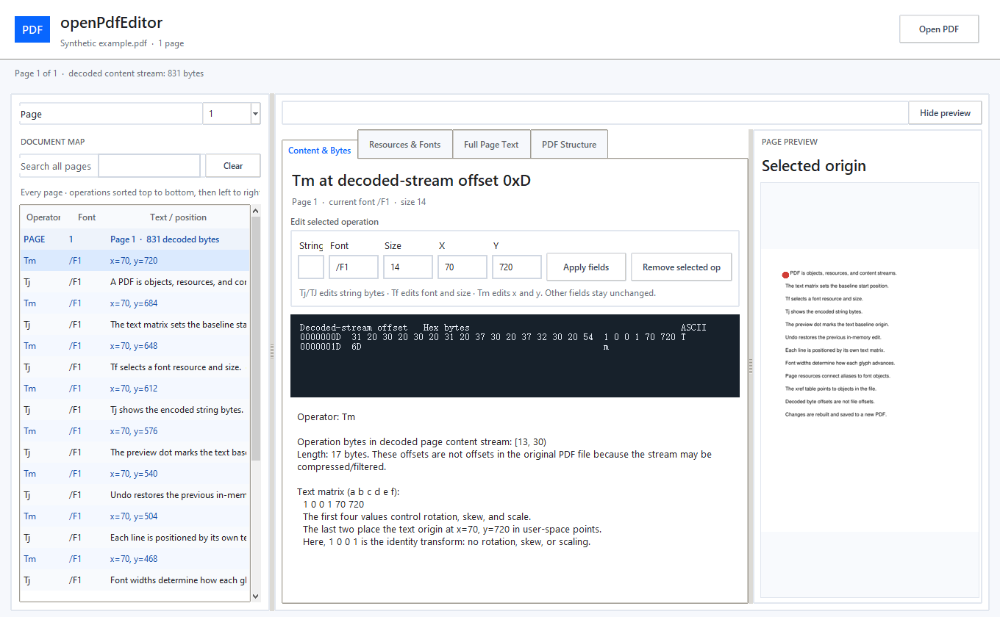
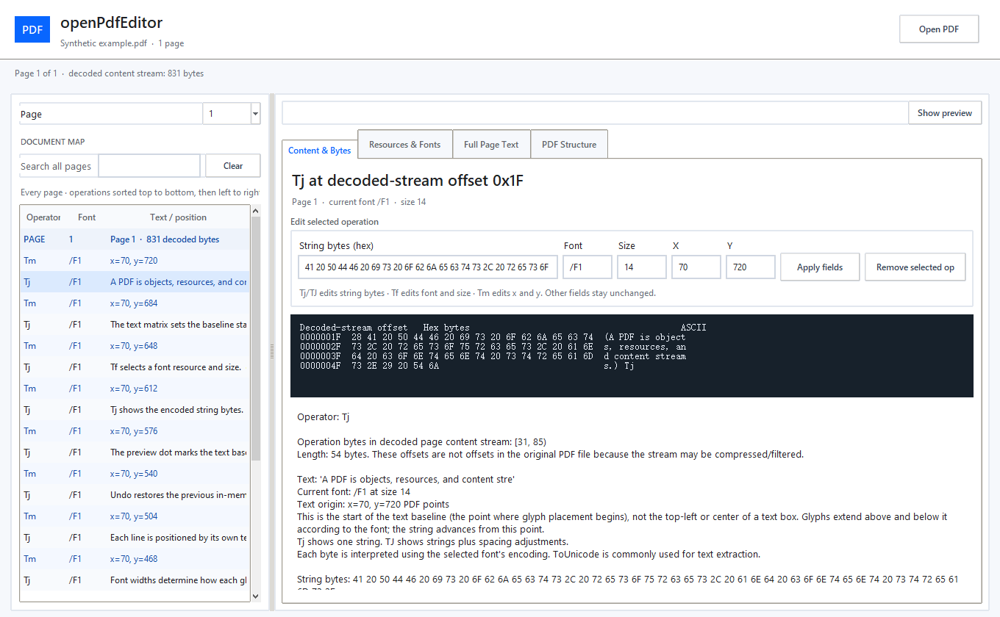

# openPdfEditor

[](https://github.com/simondong1/openPdfEditor/actions/workflows/ci.yml)
[](https://github.com/simondong1/openPdfEditor/releases)
[](LICENSE)

**Edit what other PDF editors hide.** openPdfEditor lets you inspect and change the decoded bytes and operators that draw a page, with the live PDF preview beside them. [Download the latest Windows release](https://github.com/simondong1/openPdfEditor/releases/latest) or [download `openPdfEditor.exe` directly](https://github.com/simondong1/openPdfEditor/releases/latest/download/openPdfEditor.exe).

| Edit | Inspect | Save |
| --- | --- | --- |
| Text bytes, font, size, and `Tm` position | Hex bytes, operators, page resources, font widths | Rebuilt PDF, no appended revision history |

**Private by default:** runs locally on Windows. Your original stays untouched, and the app does not upload your PDF.

## Comparison

| Capability | openPdfEditor | Acrobat / PDF-XChange | Online editors | PDF libraries |
| --- | --- | --- | --- | --- |
| Main view | Operators, bytes, resources, and page | Pages, text, forms, markup | Page editing in a browser | Code and PDF objects |
| Direct `Tm`, `Tf`, `Tj`, `TJ` editing | **Yes** | Usually hidden | No | Custom code required |
| Hex bytes and decoded offsets | **Yes** | No | No | Manual tooling required |
| Live preview linked to selected operation | **Yes** | Page preview | Page preview | No |
| PDF uploaded to a service | **No** | No | Depends on provider | No |
| Output save method | Rebuilds supported PDFs; does not append an incremental revision | Depends on product and save mode | Depends on provider | Depends on library and code |
| Best fit | Precise stream edits and PDF inspection | Document production and collaboration | Convenient one-off edits | Batch jobs and application integration |

Rebuilding removes earlier incremental revisions from the output; it does not make edits undetectable. The changed content is still in the PDF and can be compared with an original.

## Saved-file comparison

| After one edit | openPdfEditor | Acrobat / PDF-XChange | Online editor | General PDF library |
| --- | --- | --- | --- | --- |
| File layout | One rebuilt PDF | Save-mode dependent; may append a revision | Provider-defined export | Library-defined serialization |
| Old revision retained inside output | **No** | May remain when saved incrementally | Depends on provider | Depends on API and save mode |
| Size behavior | Usually close to the source; exact size depends on filters and object serialization | Often grows when a revision is appended | Export-dependent | May grow or shrink after reserialization |
| Edit history in PDF bytes | No appended revision chain | Incremental revisions may remain inspectable | Provider-dependent | Provider/library-dependent |
| Unchanged objects | Copied into the rebuilt file | Existing bytes may remain in place | Provider-controlled | Often rewritten |
| Original security setup | Preserved for supported encrypted inputs | Product-controlled | Provider-controlled | Library-controlled |

This is a behavior comparison, not a promise that every PDF will have the same byte count. A rebuilt file can be larger or smaller than its source because stream filters, whitespace, object ordering, and length values affect serialization. The important distinction is that openPdfEditor writes one complete output instead of appending the previous revision to the end.

**Why the size can change:** a one-byte decoded edit may change a compressed stream, its `/Length`, the xref offsets, and the trailer. An incremental save keeps the old bytes and appends new objects. A rebuild writes the current object set once, so it avoids retaining that old revision.

## Built for precise edits

| Workflow | What openPdfEditor gives you |
| --- | --- |
| Find a value | Search operations across pages; jump from a result to its page and preview position |
| Change the page | Edit decoded text bytes, font alias, font size, and text-matrix x/y |
| Understand the rendering | Inspect `Tf`, `Tm`, `Tj`, `TJ`, path operators, hex/ASCII bytes, byte-to-Unicode mappings, and baseline position |
| Check fonts | Follow page aliases to font objects; inspect encoding, widths, `/ToUnicode`, and digit advances |
| Trace the file | Follow page resources and content streams through indirect objects, xref entries, and the trailer |
| Stay in control | Keep edits across pages, undo with `Ctrl+Z`, and review in the live preview before saving |
| Clean unused resources | Confirm removal of unused page font aliases and empty path-paint operators; undo before saving |
| Preserve document data | Retains unrelated objects and metadata values; preserves supported encryption settings and key |

## Download first

1. Download [`openPdfEditor.exe`](https://github.com/simondong1/openPdfEditor/releases/latest/download/openPdfEditor.exe).
2. Double-click it. It is a self-contained Windows GUI application and does not open a terminal window.
3. Click **Open PDF** and choose a document. The repository does not contain sample bank statements or user documents.

The [release page](https://github.com/simondong1/openPdfEditor/releases/latest) includes the version notes and the same executable as a downloadable asset.

The release is a self-contained Windows build created with PyInstaller's GUI mode. Python and dependencies are not required. Windows may show SmartScreen for a new unsigned open-source executable; choose **More info → Run anyway** only if you downloaded the file from this repository's Releases page.

## See it in action

Open a PDF to reveal the editor. The welcome screen stays simple until a document is open.


Search across pages and select an operation to jump to its page and preview location.



Inspect and edit decoded bytes alongside the selected operator, font, size, baseline, and text.



Trace page font aliases to font objects, encodings, widths, Unicode maps, and digit advances.


Screenshots show a synthetic PDF and contain no user documents.

## Quick workflow

| Step | Do this | What you see |
| --- | --- | --- |
| 1. Find | Search all pages; select a `Tj`, `Tm`, or `Tf` operation | The page and operation highlight together |
| 2. Understand | Read decoded bytes, text, font, size, and coordinates | `Tf` selects a font; `Tm` sets the text matrix; `Tj` shows text |
| 3. Change | Edit text bytes, font, size, or x/y; use **Undo** or `Ctrl+Z` | Preview updates; edits stay pending across pages |
| 4. Save | Choose **Save All Edits** | A rebuilt PDF is written to a new file |

The preview marker is the start of the text baseline, not a text-box corner. PDF coordinates start at the lower-left. Decoded offsets count bytes after stream filters and encryption are decoded; they are not file offsets.

## PDF compatibility

| Supported for editing and rebuild | Currently unsupported |
| --- | --- |
| Unencrypted PDFs | Xref streams and compressed object streams |
| Standard Security Handler revision 2 (40-bit RC4) | Newer encryption revisions |
| Traditional xref tables and ordinary indirect objects | Nonzero object generations |
| Supported content filters and one page content stream | Multiple page content streams; unsupported filters or predictors |
| Simple fonts and common text operators | Composite fonts, complex CMaps, nested Form XObjects, and text inside images |

Unsupported layouts are rejected before writing. The source PDF is never modified; saving creates a new file.

## Run from source

```powershell
python -m venv .venv
.\.venv\Scripts\Activate.ps1
python -m pip install -r requirements.txt
python pdf_explorer.py
```

Or double-click `Run PDF Byte Explorer.bat` after installing dependencies.

## Build the Windows executable

```powershell
python -m pip install -r requirements-dev.txt
pyinstaller --noconfirm --clean --onefile --windowed --name openPdfEditor pdf_explorer.py
```

The executable is written to `dist\openPdfEditor.exe`. The tagged-release workflow performs this build automatically and attaches that single executable to the GitHub release. The release asset is the same one-file, no-terminal build linked above.

## Contributing

Issues and pull requests are welcome. Please include:

- Windows version and Python version if running from source.
- The smallest non-sensitive PDF that reproduces the behavior, or a synthetic reproduction.
- Whether the issue concerns parsing, rendering, editing, rebuilding, or the user interface.
- A short before/after description and the relevant operator or object number.

Please do not upload private financial, medical, legal, or otherwise sensitive PDFs. Redact or create a synthetic file first.

Start with an issue for a design change, then open a focused pull request. Run `python -m py_compile pdf_explorer.py` before submitting.

## Credits

Created and maintained by **Simon Dong** (`simondong1`). Built with [pypdf](https://github.com/py-pdf/pypdf), [PyMuPDF](https://github.com/pymupdf/PyMuPDF), Tkinter, Pillow, and PyInstaller.

If openPdfEditor helps you understand a PDF, please [star the repository](https://github.com/simondong1/openPdfEditor) and share improvements through issues or pull requests.

## License and responsibility

| Item | Details |
| --- | --- |
| License | [MIT](LICENSE) |
| Warranty | Provided as-is, without warranty |
| Responsibility | You are responsible for your files, edits, rights, and distribution |
| Liability | The authors and contributors are not liable for document changes, data loss, corrupted output, security consequences, or misuse |
| File handling | The tool is independent of the PDFs you process and does not upload them |
